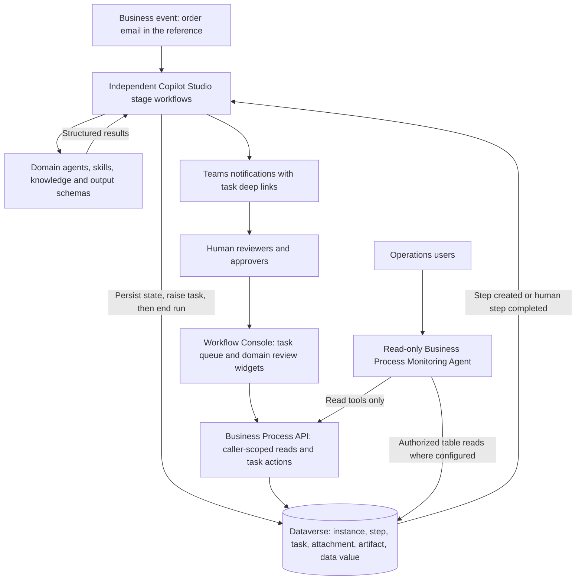

[1. Overview](1.Overview.md) > **2. Architecture** > [3. Runbook](3.Runbook.md) > [4. Sample Prompts](4.Sample-prompts.md)

# Agentic Business Process Automation Agent - Architecture

## Separation of Responsibilities

| Shared BusinessProcessCore | Business-process solution |
|---|---|
| Dataverse instance, step, task, attachment, artifact, and typed data-value tables | Intake and stage workflows with domain-specific trigger filters |
| Business Process API: authorized reads and claim/start/complete task actions | Extraction, validation, and generation agents with skills and knowledge |
| Workflow Console and task API: eligible-user queues, team/role routing checks, claim/start/complete, timeline and evidence access | Per-stage team or capability routing, widget contracts, and any specialized React review widgets |
| Process-agnostic monitoring agent | Domain reviewer/approver roles, notification flows, and environment variables |

The core ships no stage workflows. Role lookup, task creation, and Teams notification
are implemented by the process using the reusable pattern, not by a hidden core
orchestrator. Specialized widgets live in the shared console and require rebuilding
and packaging that app; they are not dynamically installed by importing a process.

## Persistent Event Contract

| Record | Purpose |
|---|---|
| `faf001_bpinstance` | Case identity, process name, descriptive business key, status, status message, and last progress time |
| `faf001_bpstep` | Stage identity, type, status, timestamps, and failure details; also the event boundary |
| `faf001_bptask` | Human assignment, required role, widget ID/input, outcome, and comments |
| `faf001_bpattachment` | Incoming documents, images, or other evidence |
| `faf001_bpartifact` | Generated files and their version/supersession metadata |
| `faf001_bpdatavalue` | Typed intermediate results, reviewed corrections, decisions, and agent outputs |

Use the instance GUID as the run identifier: `faf001_businesskey` is descriptive and
**not unique**. The data-value alternate key is instance plus data key; it does not
deduplicate incoming business events.

An automated stage listens for its named step to be created in **Not Started** state.
A post-review stage listens for its named **Human Task** step to change to **Completed**.
Step names are integration contracts and must be unique across processes. After every
step write, update the instance's status, explanatory status message, and last-progress
timestamp. Payloads belong in data-value records, not flow variables or status fields.

### Waiting Beyond 30 Days

The raising workflow writes a waiting step and task, notifies eligible users, and
terminates. Dataverse retains the waiting case. Much later, the console completes the
task through the API; the completed step starts a **new** workflow run.

This removes a single run's lifetime from the case lifetime. It does not remove request
quotas, connection expiry, flow suspension, storage/retention limits, or deployment
compatibility concerns. Persisted state provides a recovery checkpoint, not automatic
replay of a failed or missed event. Define recovery and retention before production.

## Team- and Role-Based Task Routing

The console and task APIs provide the same eligibility and task-lifecycle contract to
users across functions and locations. A process defines each stage's routing; geography
is not inferred from a user's location. The current API applies these rules:

| Task routing/state | Who can see or claim it through the task queue API |
|---|---|
| Already assigned to a person | That assignee; another user cannot claim it |
| Unassigned, with `faf001_requiredrole` | Users holding that exact role directly or through a team |
| Unassigned, no required role, with `faf001_assignedteam` | Members of the assigned Dataverse team |
| Unassigned, no role or team | No eligible claimant; unrouted tasks are denied |

A required role takes precedence over assigned-team membership: populating both does
**not** enforce a role-and-region intersection. Use an appropriately scoped role or
team-only route, or implement an explicitly authorized policy extension when both
conditions must hold. Notification recipients do not acquire task eligibility merely
by receiving a Teams link.

`faf001_AssignTask` claims for the effective caller and accepts no target assignee.
It is not a dispatcher or reassignment endpoint. Cross-functional and regional handoffs
are modeled as routed stage tasks, not arbitrary supervisor reassignment. Automated
load balancing, follow-the-sun scheduling, cross-business-unit role resolution, and
cross-tenant routing require additional design and validation. The reference's role
lookup assumes a single business unit.

## Human Review and Concurrency

1. Configure the stage's team or required-role route; the order reference resolves its
   required Dataverse security role by name when raising the task.
2. Discover eligible users and send Teams links to the specific console task.
3. The user claims and starts the task through `faf001_AssignTask` and
   `faf001_StartTask`; competing claims are protected by row-version checks.
4. The widget submits a decision, notes, and typed values through `faf001_CompleteTask`.
5. Completion transactionally saves the task outcome and outputs and closes the step,
   or fails without partially completing those writes.

The order reference registers `extracted-order-review-ui` for document/data correction
and `order-evaluation-review-ui` for evaluation review. The latter reuses a generic
data-review component. Reuse an existing widget before building another.

Widget output keys use the widget ID without its trailing `-ui`, such as
`extracted-order-review.decision` and `extracted-order-review.edited_order`.
Downstream workflows must read the agreed keys and explicitly handle approval,
rejection, and `needs_info`; a completed step is not itself an approval.

## Reference Order Lifecycle

`mail-order-intake` -> `extract-order-data` -> human extraction review ->
`validate-order` -> human evaluation review -> `finalize-order`.

The four workflows use an inline extraction agent, an Order Validation Agent with
product/availability/promotion skills, and a SAP File Integration Agent. The reference
solution packages the two published agents; the extraction node is not a third
published agent. Approved finalization stores an SAP-shaped JSON artifact, not a
confirmed ERP transaction. Catalog, inventory, and promotion knowledge is demo data.

## Monitoring and Security Boundaries

The monitoring agent discovers process names, business references, tasks, and output
keys from returned records. It can therefore serve claims, contracts, or any other
process **using this tracking contract**, without an order-specific agent dependency.
It is not an automatic monitor of unrelated workflow engines or external systems.

It is strictly read-only: it must not assign, start, complete, repair, or restart work.
Use the console for authorized task actions. The API executes as the effective caller;
verify the actual monitoring-tool connection identity and data visibility in the
target channel. Do not equate role-based task eligibility with permission to read all
process records or source documents.

Treat document text and stored outputs as untrusted data. Keep prompts and skills
separate from that content, restrict tools, validate structured outputs, and require
qualified human decisions for regulated or consequential actions.

Task transactions do not establish end-to-end exactly-once processing. Intake
deduplication, stage replay protection, outbound idempotency, timeout/escalation policy,
compensation, retention, and alerting must be designed and tested for the target process.
See the [upstream contracts](0.Resources/README.md) before extending or deploying.
